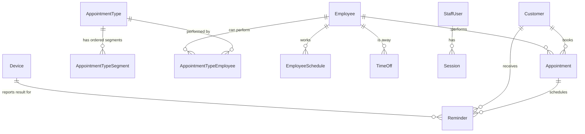

# Self-hosted salon booking system + Android SMS reminder gateway

## 📝 TLDR

A single hair/nail salon needs to run its own appointment book, because off-the-shelf salon SaaS does not model its scheduling: an appointment is not one solid block of an employee's time, but a sequence of active and **gap** segments (e.g. color processing time) during which the employee can take another client. This spec proposes a self-hosted, single-tenant TypeScript monorepo: a **booking core** (Phase 1) that computes gap-aware availability and is fully usable on its own, and a **reminder satellite** (Phase 2) — a dedicated Android phone that sends customer SMS from the salon's own SIM, so reminders carry no third-party SMS bill. The phone is not independent: it is a client of a frozen queue + sync contract (introduced in Phase 1), which is what makes the sending mechanism replaceable.

## 📝 Problem Statement

Today the salon runs on paper/phone/Google Calendar. That cannot express:
- an appointment type whose total time includes gaps during which the assigned employee is free (capacity is time-varying inside a single appointment);
- which employees are allowed to perform which appointment types;
- an employee capacity above one (chairs/parallel work).

The user evaluated mainstream salon tools (Fresha, Booksy, Square Appointments, Zenoti) and none fit the exact gap semantics, so the build-vs-buy call is **build**. The salon also wants customer reminders but will not pay a recurring SMS API — instead it has a **dedicated business Android phone** at the salon to send from its own SIM. Reminders are believed to reduce no-shows; that is an assumption this design lets us test, not a proven fact.

## 📝 Proposed Solution

One monorepo delivering a **booking core** plus a **reminder satellite** (a phone client), coupled only by a frozen reminder-queue contract:

```mermaid
flowchart LR
  Staff[Staff browser] -->|tRPC| Server[Booking server (Fastify + tRPC)]
  Server --> DB[(SQLite, WAL)]
  Server --> Engine[packages/core: gap-aware availability engine]
  Web[apps/web: React SPA] -->|tRPC| Server
  Server -->|reminders queue + sync API| Seam{{Frozen reminder seam}}
  Phone[apps/android: dedicated SMS gateway] -->|poll / report| Seam
  Phone -->|SmsManager| SIM[Salon SIM]
  SIM -.SMS.-> Cust[Customer phone]
```
**Takeaway:** the booking core (left) never depends on the sender: it only writes rows into the reminder queue. The phone (right) consumes a frozen `/sync/v1` contract, so an unreliable phone can be replaced by a GSM modem or a paid API without touching booking logic. The reminder queue ships in Phase 1 only so the contract is settled early; it is an add-on layer over the core, and the core is useful with nothing ever sent.

Alternatives considered: adopting a SaaS (rejected — gap semantics, ownership); a third-party SMS API (rejected — recurring cost); a cloud VPS (rejected — on-prem ownership; SQLite is sufficient for one salon); React Native for the phone app (rejected — a single-purpose background sender does not justify a native bridge).

## 📝 Resolved assumptions (autonomous defaults)

The brainstorm brief resolved the major unknowns (single tenant; internal staff tool; on-prem but remotely reachable; TypeScript monorepo; build not buy; EU SMS; one phased spec). Remaining design questions were resolved as follows; override any of these before implementation.

| # | Question | Applied default | Why | Confirm? |
|---|----------|-----------------|-----|----------|
| A1 | Calendar component for the resource timeline (employees × time, with gap sub-blocks) | Free path: a **custom CSS-grid/absolute-positioned timeline** (note `react-big-calendar` has no first-class resource/timeline view). Paid path: **FullCalendar Premium** resource timeline. Decide in the Phase 1 step 2 prototype | FullCalendar's resource-timeline view needs a **paid license** — a spend decision for the owner — and swapping libraries later rebuilds the hardest UI. A spike de-risks before the choice is locked. | ⚠ NEEDS HUMAN CONFIRMATION |
| A2 | Reminder lead time(s) and cadence | One reminder per appointment, **configurable lead time default 24 h**, editable in Settings | Smallest useful behaviour; adding "24 h + 2 h" later is additive | reversible |
| A3 | Quiet hours | Default **09:00–20:00 salon-local**; a reminder whose time falls outside is shifted to the next in-window time | Avoids texting customers at night; a config value, not a schema choice | reversible |
| A4 | Outbound vs two-way SMS | **Outbound only.** Replies are not processed; customers call the salon | Reuses the phone as a dumb sender; parsing replies is a much larger feature | reversible |
| A5 | Employee capacity meaning | **Maximum concurrent active segments** for that employee; default 1. Gaps never count toward capacity | Matches "take another client during processing time"; one integer stays flexible for multi-chair salons | reversible |
| A6 | Working hours | Store per-employee weekly hours + time-off exceptions; the UI may collapse to salon-wide hours in Phase 1 | A book that ignores when people work is not usable; modeled minimally and simply | reversible |
| A7 | Customer SMS consent / opt-out (EU) | Store an `smsOptOut` flag per customer; **v1 processes no inbound replies** — staff mark opt-outs manually in the UI. Reminders are transactional and sent only to numbers the salon already holds | Keeps v1 outbound-only; consent state has a home from day one and must not be weakened later | ⚠ NEEDS HUMAN CONFIRMATION (legal/consent posture) |
| A8 | Remote reachability | **Tailscale** tailnet for staff-remote access and the phone; no port-forwarding | Ownership without exposing the LAN; swap for a tunnel later | reversible |
| A9 | Calendar freshness across devices | Poll/refetch (TanStack Query staleness), no websockets | One salon, few users; real-time collaboration was excluded in the brief | reversible |
| A10 | Staff accounts | Seeded admin + optional additional staff accounts with `admin`/`staff` roles; no self-registration | One salon; smallest auth that is not insecure | reversible |

## 📝 Architecture

**Monorepo** — pnpm workspaces + Turborepo.

- `packages/core` — pure TypeScript, zero runtime deps: the domain entities (Zod schemas) and the **availability engine**. `computeAvailability(employeeIds, typeId, range, existingAppointments, schedules)` returns bookable slots and, for a chosen slot, the resolved segment plan. This is the differentiator and is fully unit-testable without I/O.
- `apps/server` — Fastify + tRPC (typed client for the web app), Drizzle ORM on **SQLite (WAL)** via `better-sqlite3`, Zod at every boundary, argon2 cookie sessions for staff. Owns the **`reminders` queue** and the device sync endpoints. Runs the reminder scheduler in-process (interval tick; no external queue).
- `apps/web` — React + Vite SPA, TanStack Router + Query, resource-timeline calendar.
- `apps/android` — pure Kotlin gateway: WorkManager periodic sync, Room outbox, `SmsManager` + `SEND_SMS`, Retrofit client. Sideloaded APK.
- Deployment — Docker Compose (server + Caddy reverse proxy) on a mini-PC/Raspberry Pi; Caddy issues TLS; Tailscale for remote; nightly SQLite backup.

**Current consumers / dependencies:** none yet (greenfield). The Android app depends on the reminder seam, which is why the seam is frozen and versioned in Phase 1 before the app exists.

**Data access** stays in `apps/server`; the engine in `packages/core` receives plain data and returns plain data, never a DB handle.

## 📝 Data Model


**Takeaway:** the appointment carries a **snapshot** of its resolved segment plan (below), so editing an appointment type never rewrites booked history — the graph stays stable and history stays truthful.

Key tables (Drizzle/SQLite):
- `customer` — `id`, `name`, `phoneE164` (unique, indexed), `phoneRaw`, `email?`, `notes?`, `smsOptOut` (bool, default false), timestamps.
- `employee` — `id`, `name`, `active`, `capacity` (int ≥ 1, default 1), `color`, timestamps.
- `appointment_type` — `id`, `name`, `active`, `bufferBeforeMin`, `bufferAfterMin`, `color`. **Buffers are reserved *active* time**: they occupy the employee (count toward capacity and against availability) and are included in the computed `endAt`; they are not gaps. Both appear in `planJson` as first/last active segments so history and reminders stay exact.
- `appointment_type_segment` — `id`, `appointmentTypeId`, `position`, `kind` (`active`|`gap`), `durationMin`, `label?`. Total duration = Σ durations.
- `appointment_type_employee` — (`appointmentTypeId`, `employeeId`) capability mapping.
- `employee_schedule` — `id`, `employeeId`, `weekday` (0–6), `startMin`, `endMin` (minutes from local midnight). **Multiple rows per weekday are allowed**, so lunch breaks and split shifts are expressible.
- `time_off` — `id`, `employeeId`, `startAt`, `endAt` (UTC), `reason?`.
- `appointment` — `id`, `customerId`, `employeeId`, `appointmentTypeId`, `startAt` (UTC), `endAt`, `status` (`scheduled`|`completed`|`cancelled`|`no_show`), `planJson` (snapshot of segments with absolute offsets), `notes?`, timestamps. Index (`employeeId`, `startAt`).
- `reminder` — `id`, `appointmentId`, `customerId`, `phoneE164`, `body`, `scheduledFor` (UTC), `status` (`pending`|`claimed`|`sent`|`failed`|`cancelled`), `attempts`, `leaseUntil?`, `claimedByDeviceId?` (FK to `device`, set when claimed), `sentAt?`, `errorMessage?`, `idempotencyKey` (unique), timestamps. `claimedByDeviceId` is what makes the `Device`↔`Reminder` relationship real and gives the dashboard a send audit.
- `device` — `id`, `name`, `tokenHash`, `lastSeenAt?`, `active`.
- `staff_user` — `id`, `email` (unique), `passwordHash` (argon2), `role` (`admin`|`staff`), `active`.
- `session` — `id`, `userId`, `tokenHash`, `expiresAt`.
- `setting` — `key` (PK), `value` (JSON text) — salon name, address, timezone, reminder lead minutes, quiet-hours window, and `reminderTemplate` (see API Contracts). A message **template** is a setting, not a new entity, to keep the surface small.

**Sensitive data:** customer name + phone are PII. Stored in the on-prem SQLite file; access only after staff auth; never logged in full. Device tokens stored hashed. No PII in reminder logs beyond an appointment/reminder id.

## 📝 API Contracts

**Device sync REST (frozen contract — Phase 1, consumed by Phase 2).** Device identity is the bearer token; the server attributes every claim and result to the authenticated device (`claimedByDeviceId`) — no device id is passed in bodies.

- `POST /sync/v1/reminders` — auth `Authorization: Bearer <deviceToken>`. **Due-ness is decided on the server's own clock**, not the phone's. Returns only reminders that are `pending` (`scheduledFor <= serverNow`), still before their cutoff (appointment start + 15 min; the server `cancelled`s ones past it rather than returning them), and whose customer is not opted out: `{ reminders: [{ id, phoneE164, body, idempotencyKey, appointmentStartAt, scheduledFor }], leaseSeconds: 1800, serverTime }`. Each returned reminder moves to `claimed` with `leaseUntil = serverNow + 30 min` and `claimedByDeviceId`; a `claimed` row whose lease expired reverts to `pending`. `appointmentStartAt` lets the phone apply its own last-minute guard without trusting its clock for due-ness.
- `POST /sync/v1/reminders/results` — body `{ results: [{ id, idempotencyKey, status: "sent"|"failed", sentAt?, error? }] }`. Idempotent by `idempotencyKey`: a repeat for an already-`sent` reminder is a no-op. Records `claimedByDeviceId` for the reporting device. Returns `{ applied, ignored }`.
- `POST /sync/v1/hello` — body `{ appVersion }`; updates `lastSeenAt`; returns `{ salonName, address, pollIntervalMinutes }`.
- Versioned under `/sync/v1/...`; **additive fields only within v1** (a sideloaded app cannot be force-updated), per `BACKWARD_COMPATIBILITY.md`.

**Message template.** `setting.reminderTemplate` defaults to a short transactional message:
`"{salonName}: reminder — {serviceName} on {date} at {time}. To change or cancel, call {salonPhone}."`
Placeholders (`salonName`, `serviceName`, `date`, `time`, `salonPhone`, `address`) are substituted at queue time; the rendered result is stored in `reminder.body`. Keep messages within one GSM-7 segment where practical (~160 chars) — the default fits; the phone must not send an empty or placeholder-unsubstituted body.

**Device token provisioning.** The admin creates a device in Settings → "Add device", which shows a one-time raw token (stored hashed as `device.tokenHash`); it is typed/pasted into the phone app once during setup. Rotation creates a new token and invalidates the old.

**Web (tRPC, typed):** `auth.*` (login/logout/me), `customers.*`, `employees.*`, `appointmentTypes.*`, `appointments.*` (list by range, create, update, cancel, complete, noShow), `availability.query(range, employeeIds, typeId)`, `reminders.*` (list by status, retry, cancel), `devices.*` (create token, revoke), `settings.get/set`.

Validation: every body parsed with Zod; unknown/invalid device token → 401; `phoneE164` validated E.164.

## 📝 UI/UX

- **Login** — email + password; no signup.
- **Calendar** (primary) — resource timeline: employees as rows, time as columns, day/week view. Each appointment renders as a block whose **gap segments are visibly hollow/dimmed**, so staff can see the free window inside a service. Clicking a free cell starts a new appointment for that employee/time; clicking a block opens the edit drawer. A "capacity" cue shows employees already at capacity.
- **Appointment drawer** — pick/create customer (search by name or phone), pick type (filtered to types the selected employee can perform), choose a slot the engine allows, then show the resolved segment plan (active/gap times) before saving. Conflict/over-capacity is blocked by the engine, not the UI.
- **Customers** — list with search, detail with appointment history and an **SMS opt-out** toggle.
- **Employees** — CRUD, capacity, weekly hours, time-off, and capability checkboxes.
- **Appointment types** — CRUD plus an ordered **segment editor** (add active/gap rows, reorder, set minutes) and employee capability mapping.
- **Reminders** — dashboard by status (pending / sent / failed), **which device** claimed/sent each (audit from `claimedByDeviceId`), the **device last-seen** indicator, a manual retry, and a **no-show count** for the period (the surface that lets the reminder-ROI premise be checked without reading the DB by hand).
- **Settings** — salon name, address, phone, timezone, reminder lead time, quiet hours, the **reminder message template**, and device token management (add/rotate/revoke).

States to design for each screen: default, empty, loading, error, no-permission (non-admin), long content, narrow viewport. **Prototype:** none yet — Phase 1 step 2 produces the calendar/timeline prototype; this spec is text-only (no browser provider installed at authoring time).

## 📝 Edge Cases & Failure Scenarios

- **Capacity > 1 / overlapping bookings** — the engine counts overlapping *active* segments against capacity; a gap frees capacity. Two staff booking the same free window must not both succeed: booking is validated transactionally against current appointments.
- **Type edited after booking** — the appointment's `planJson` snapshot is authoritative for history and reminders; new bookings use the new definition.
- **Customer has no/bad phone** — no reminder is created; the appointment is flagged in the Reminders dashboard.
- **Phone offline for days** — reminders pile up as `pending`. On sync the **server** owns the cutoff: it `cancelled`s any whose appointment start + 15 min has passed and returns only still-valid ones; the phone additionally drops anything whose `appointmentStartAt` is already past before sending. Nothing stale is texted.
- **Rescheduled appointment** — changing `startAt` recomputes the reminder: a `pending` row's `scheduledFor` (and re-rendered `body`, if the date/time placeholders changed) moves to the new lead time; an already-`sent` row is left untouched. A `claimed` row is released back to `pending` first so the old payload is not sent.
- **Double send** — prevented by `idempotencyKey` on both sides plus the Room outbox; a repeated result POST is a no-op.
- **Quiet hours / DST** — reminders outside the window shift forward; all stored times are UTC, display and window math use the salon timezone; DST is handled by timezone-aware conversion, not fixed offsets.
- **Cancelled appointment** — its `pending` reminders are cancelled.
- **Device token revoked / stolen phone** — revoke invalidates sync (401); reminders revert to `pending` for a replacement device; the phone holds no PII beyond queued messages.
- **Server unreachable when the phone polls** — phone retries with backoff; nothing is lost because the queue is server-side.
- **OEM background killer / reboot** — WorkManager reschedules; boot receiver re-registers; missed windows degrade to "later", never to duplicate sends.
- **Over-capacity race** — the availability check and insert run in one SQLite transaction.

## 📝 Risks & Impact Review

- **SMS deliverability (EU, long-code SIM)** — untested and the true go/no-go. *Gate:* before Phase 2 build, send ~20 real messages from the actual SIM to several EU networks. If they are filtered, the seam swaps in a GSM modem — a real branch, not a formality: building it is a separate step, and Phase 2 acceptance is **manual** (physical phone, real SIM) and therefore outside the automated `validation.commands` gate. This gate does not affect Phase 1.
- **Dedicated phone reliability** — permanent charging (battery swelling), OEM task-killers, theft, reboots. *Impact:* missed reminders. *Mitigation:* the seam isolates it; the Reminders dashboard surfaces device silence; a modem is the fallback.
- **Calendar timeline complexity** — the hardest UI; a wrong library choice is expensive (see A1). *Mitigation:* prototype before committing; `⚠ NEEDS HUMAN CONFIRMATION` on any paid license.
- **GDPR / consent** — transactional reminders to numbers the salon already holds are the low-risk case, but consent state and opt-out must be respected (A7). No weakening later without a decision.
- **Reminder ROI unproven** — the whole phone gateway is justified only if reminders reduce no-shows. *Falsifiable check:* compare no-show rate before/after Phase 2 for a period.
- **Frozen contract** — the `/sync/v1` API and `reminders` schema are protected (`BACKWARD_COMPATIBILITY.md`); changing them strands a sideloaded app.
- **Scope** — deliberately single-tenant, no payments, no public booking, no iOS, no staff mobile app; roles are intentionally coarse (`admin`/`staff`) and can be collapsed to a single account if even that is unwanted.

## 📋 Phasing

- **Phase 1 — Booking core + the reminder-seam layer (the core ships and is usable with nothing ever sent).** Customers, employees (+capacity, hours, time-off), appointment types (segments + capability), the availability engine, the calendar UI, plus the `reminders` queue and the frozen `/sync/v1` endpoints. The reminder layer is an add-on over the core — it has no consumer until Phase 2 and is bundled here only so the contract is settled and testable early; if you prefer, it can be deferred to its own phase without touching the core. It could equally be split into its own spec; it is kept in this one because it is small, server-only, and the user chose a single phased spec.
- **Phase 2 — Android SMS gateway (a client, not an independent capability).** Pure-Kotlin app that syncs and sends via `SEND_SMS`, plus the deliverability pilot that gates it. It depends entirely on Phase 1's seam and changes nothing in the core.

## 📋 Implementation Plan

**Phase 1 — Booking core + reminder seam**

1. **Monorepo scaffold** — pnpm workspaces + Turborepo; `packages/core`, `apps/server`, `apps/web` skeletons; shared tsconfig/eslint; set `validation.commands` in `.ai/agentic.config.json`. *(Leaves app building/empty.)*
2. **Calendar/timeline prototype** — throwaway static prototype of the resource timeline with gap sub-blocks; decide free lib vs custom (A1). *(Produces the UI decision; no production code.)*
3. **Core domain + engine** — Zod entities and `computeAvailability` with gap/capacity semantics **and buffer occupancy**; unit tests for gaps, capacity > 1, overlaps, buffers, split shifts/breaks, and time-off. *(Pure module, tested.)*
4. **Server foundation** — Fastify + tRPC + Drizzle/SQLite; migrations for all tables; staff auth (argon2 + sessions) and a seeded admin. *(Login works.)*
5. **Customers & employees CRUD** — API + web screens (list/detail/forms), opt-out flag, capacity, hours, time-off. *(Manageable data.)*
6. **Appointment types** — segment editor + capability mapping; server validation. *(Types definable.)*
7. **Appointments + availability** — create/update/cancel via engine-validated transactions; calendar view wired to real data; conflict prevention. *(Core product usable.)*
8. **Reminder queue** — scheduler computing reminders from Settings (lead time, quiet hours, template rendering); create/update is idempotent on `idempotencyKey` so re-runs and reschedules never duplicate; status lifecycle; `/sync/v1/hello|reminders|results` with leases, device attribution, and idempotent results; Reminders dashboard (pending/failed, which device, last-seen, no-show count). *(Seam frozen and observable; nothing sent yet.)*
9. **Deployment + backup** — Docker Compose (server + Caddy), Tailscale notes, nightly SQLite backup, seed script. *(Runs on the salon's mini-PC.)*

**Phase 2 — Android SMS gateway**

10. **Deliverability pilot (gate)** — send ~20 test SMS from the salon SIM to multiple EU networks; decide go, or take the **GSM-modem fallback branch** (a separate build) if filtering blocks long-code sends.
11. **Android app** — Kotlin + Retrofit/Room/WorkManager; `/sync/v1` client; `SEND_SMS` sending with **explicit dual-SIM `subscriptionId`** selection and **GSM-7 length/segmentation** handling; outbox with idempotency; boot + periodic workers; device token pasted from Settings. *(Dedicated phone sends due reminders.)*
12. **End-to-end verification** — book → queue → phone sends → result recorded → Reminders dashboard shows `sent`; offline/reboot/duplicate scenarios exercised. *(Feature complete; no-show metric baseline can start.)*
